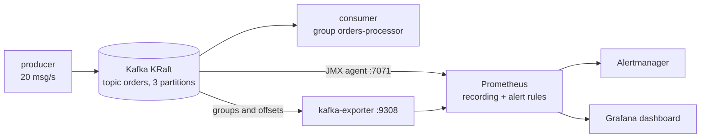
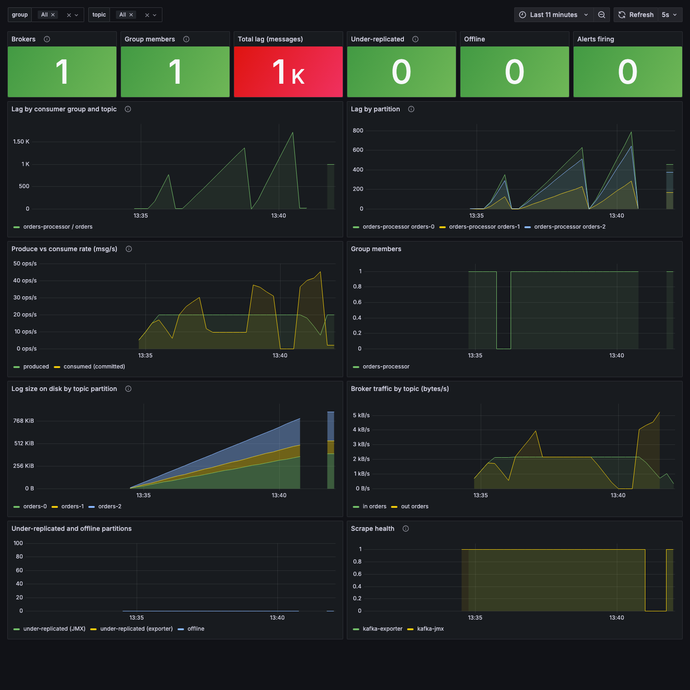

# kafka-lag-monitoring

Monitoring for a Kafka consumer group that falls behind, with alerts that tell a dead consumer from a stuck one and from a slow one.

Consumer lag by itself is a weak signal: it grows when the consumer process is gone, when it is alive but hung on a dependency, and when it simply cannot keep up with the producers. The three have different fixes (restart, look inside the process, scale or find the slow call), so the alerts here are built to say which case it is. The same idea as in [queue-saturation-observability](https://github.com/Walaskien/queue-saturation-observability), applied to Kafka.

It contains:

- a Docker Compose stack: one Apache Kafka 3.9 broker in KRaft mode (no ZooKeeper) with the Prometheus JMX exporter as a java agent, [kafka-exporter](https://github.com/danielqsj/kafka_exporter) for consumer group lag, Prometheus, Alertmanager and Grafana;
- a small Python producer and consumer (`confluent-kafka`) whose speed, per-message delay and pause can be changed over HTTP, to create lag on demand;
- Prometheus recording and alerting rules covered by `promtool` unit tests;
- a Grafana dashboard provisioned from JSON, a [runbook](docs/runbook.md) (symptom, check, action) and a [recorded incident](docs/incident-consumer-stop.md) with real output;
- `scripts/scenario.sh`, which walks through four failures and waits for the right alert each time. CI runs it on every push.

This is a reference setup for learning and for starting your own rules, not something that ran in front of customers. Check thresholds and `for:` durations before using it on a real cluster.

## How it works



Metrics and where they come from:

| Need | Metric | Source |
|---|---|---|
| Lag per group and partition | `kafka_consumergroup_lag` | kafka-exporter |
| Group members | `kafka_consumergroup_members` | kafka-exporter |
| Produce and consume speed | `kafka_topic_partition_current_offset`, `kafka_consumergroup_current_offset` (rates) | kafka-exporter |
| Under-replicated, offline partitions | `kafka_under_replicated_partitions`, `kafka_offline_partitions` | JMX agent |
| Log size on disk | `kafka_log_size_bytes` | JMX agent |
| Broker traffic | `kafka_topic_bytes_in_total`, `kafka_topic_bytes_out_total` | JMX agent |

## Alerts

`prometheus/rules/alerts.yml`. The three consumer alerts cannot fire together for one group, that is the point:

| Alert | Members | Committed offsets | Lag | Action |
|---|---|---|---|---|
| `KafkaConsumerGroupNoMembers` | 0 | frozen | above 0 | start the consumer |
| `KafkaConsumerStuck` | 1+ | frozen | above 0 | the process is alive but not working, look inside |
| `KafkaConsumerLagGrowing` | 1+ | moving | above 100 and growing | slower than the producers, scale or fix the slow call |

Also: `KafkaBrokerMetricsMissing` (JMX target down or absent), `KafkaExporterDown`, `KafkaUnderReplicatedPartitions`, `KafkaOfflinePartitions`. Alertmanager inhibits the consumer alerts while the broker or exporter alert fires, and `Stuck` and `LagGrowing` while the same group has `NoMembers`.

## Try it

Needs Docker with Compose and about 1 GB of free memory (measured at about 520 MiB for the whole stack, 360 MiB of it the broker). The first build pulls the Kafka image (about 600 MB) and downloads the JMX agent jar, whose SHA-256 is checked in the Dockerfile.

```console
make up                # build and start everything
make alerts            # one-line state of the group and what Alertmanager holds
make consumer-slow     # 100 ms per message: slower than the producer
make consumer-fast
make consumer-pause    # stays in the group, takes nothing
make consumer-resume
docker compose kill consumer     # the process dies; `start` brings it back
make describe          # kafka-consumer-groups.sh --describe
make scenario          # all four failures in a row, about 8 minutes with the warm-up
make down
```

Ports are non-default and bound to localhost: Grafana http://localhost:13000 (anonymous viewer, `admin`/`admin` is a demo password), Prometheus :19090, Alertmanager :19093, kafka-exporter :19308, producer and consumer control :19101 and :19102 (`GET /state`, `POST /rate/50`, `/process-ms/100`, `/pause`, `/resume`).

## What it looks like

Dashboard after one `make scenario` run (last 11 minutes). Lag spikes: consumer killed, consumer slow, consumer stuck. The gap on the right is the broker stop, the scrape health panel shows both jobs down.



The [recorded incident](docs/incident-consumer-stop.md) has the timeline of the first failure with the real output: lag per 5 s, the alert firing 46 s after the kill, `kafka-consumer-groups.sh --describe` with no members, offset reset dry runs, recovery.

## Verified

Local runs on macOS (Colima, Docker 29), Python 3.9.6, docker-compose 1.29.2 from a venv.

| Check | Result |
|---|---|
| `pytest -q` (control API, pacer, message format, `promq` helper against a stub HTTP server) | 34 passed |
| `ruff check .` (0.17.4) | all checks passed |
| `promtool check config` and `check rules` (prom/prometheus v2.55.1) | success, 3 recording and 7 alerting rules |
| `promtool test rules prometheus/tests.yml` | success, 8 test groups: healthy, consumer dead, stuck, slow, recovery (alert resolves), broker target down, broker series absent, under-replicated |
| `amtool check-config` | valid, 2 inhibit rules, 1 receiver |
| `shellcheck scripts/*.sh`, `actionlint` | no findings |
| `docker-compose config -q` | valid (CI uses `docker compose`) |
| `scripts/scenario.sh` on a freshly built stack, exit code 0 | consumer killed: `KafkaConsumerGroupNoMembers` after 46 s, lag back under 50 within 16 s of the restart. Slow consumer: `KafkaConsumerLagGrowing` after 139 s. Paused consumer: `KafkaConsumerStuck` after 94 s. Broker stopped: `KafkaBrokerMetricsMissing` after 35 s, plus `KafkaExporterDown`. For each failure the other consumer alerts were checked to be inactive. All five alerts resolved afterwards, and Alertmanager received `KafkaConsumerGroupNoMembers` and `KafkaBrokerMetricsMissing`. Output: [docs/scenario-output.txt](docs/scenario-output.txt) |
| Grafana provisioning | dashboard "Kafka consumer lag" found through `/api/search`, screenshot taken from the running stack with headless Chrome |
| Runbook commands against the demo broker | `--list`, `--describe`, `--describe --state`, `--describe --members --verbose`, `kafka-topics.sh --describe`, `--under-replicated-partitions`, `--unavailable-partitions`, `--alter --partitions` (on a scratch topic), `kafka-log-dirs.sh`, `--reset-offsets` dry runs (error on an active group, offsets printed on an empty one) |

Not verified: the GitHub Actions workflow has not run yet, so nothing here is marked as checked in CI. Also not run: `pytest` on Python 3.12 (it is in the CI matrix), `--reset-offsets --execute`, scaling the consumer to several instances, more than one broker (so the under-replicated and offline alerts are covered by `promtool` tests only), and any real workload.

## Limits

- One broker, PLAINTEXT, no auth or TLS. The producer and consumer control endpoints have no auth and are bound to localhost.
- Thresholds are starting points. `for:` durations are short so the demo reacts in about a minute, and `lag > 100` is an absolute number that only makes sense at 20 msg/s. For a real topic use a lag-in-seconds threshold or per-topic values.
- The "stuck" case is simulated with `consumer.pause()`, which keeps the consumer in the group. A real hang (blocked on a database call) looks the same to the broker, but I only tested the simulation.
- Rates are `rate()` over one minute, so they trail by up to a minute and overstate the consumed speed after a drain (see the incident page). A manual offset reset shows up as a one-off spike.
- `kafka-exporter` sometimes left out `kafka_consumergroup_lag_sum` in a scrape, so the rules sum the per-partition series themselves. It only reports groups that have committed offsets; an empty group with zero lag does not alert on purpose, and groups created by CLI tools stay visible until their offsets expire.
- While the broker is down the exporter fails its scrapes and the group metrics disappear, so lag alerts cannot fire. `KafkaBrokerMetricsMissing` and `KafkaExporterDown` cover that case.
- Alertmanager has an empty receiver on purpose (no secrets in the repo).
- The broker's log size panel comes from the JMX agent, not from kafka-exporter, which has no byte sizes.

## Repository layout

```
docker-compose.yml   broker, topic init, kafka-exporter, producer, consumer, Prometheus, Alertmanager, Grafana
kafka/               Dockerfile (Kafka 3.9.1 + JMX agent), jmx-exporter.yml
app/                 producer.py, consumer.py, common.py (pacing, control API, message format)
prometheus/          prometheus.yml, rules/ (recording, alerts), tests.yml (promtool unit tests)
alertmanager/, grafana/   configs, inhibit rules, provisioned dashboard
scripts/, tools/     scenario.sh, promq.py (Prometheus and Alertmanager queries for the scenario)
docs/                runbook.md, incident-consumer-stop.md, scenario-output.txt, img/
tests/               pytest for app/common.py and tools/promq.py
.github/workflows/   ci.yml
```

## What I would improve next

- A lag-in-seconds alert (lag divided by consume rate) instead of absolute message counts.
- Several brokers, so under-replicated partitions can be shown for real, and a replication factor of 3.
- A receiver in Alertmanager (chat or email) with a routing example by severity.
- A cooperative-sticky consumer case: how a rebalance storm looks in these metrics.
- Run the consumer as several instances to check the "more consumers than partitions" advice from the runbook.

## Related

- [queue-saturation-observability](https://github.com/Walaskien/queue-saturation-observability): the same question for RabbitMQ, Redis lists and spool directories, with a host-versus-queue bottleneck check. The rules and runbook here follow the same layout.
- [sre-slo-observability](https://github.com/Walaskien/sre-slo-observability): SLOs and burn-rate alerts on a similar Prometheus, Alertmanager and Grafana Compose stack.
